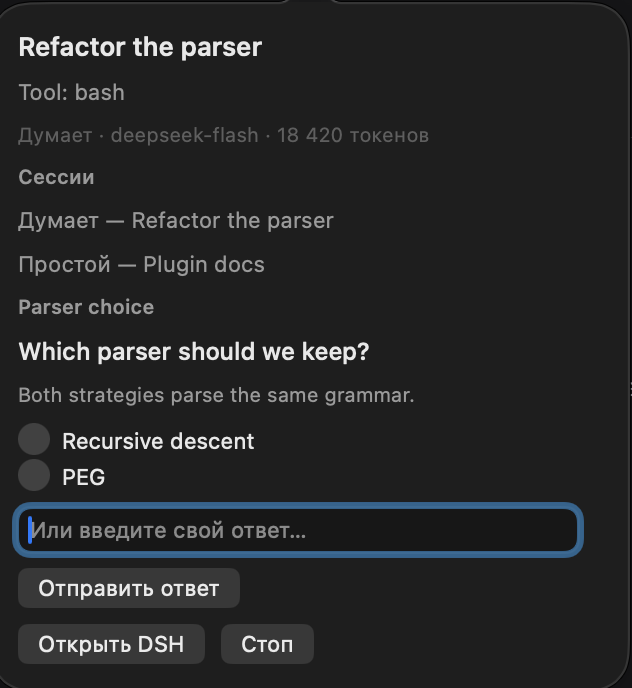
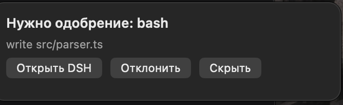

# DSH Bar

[](https://github.com/reg4916/dsh-bar/actions/workflows/ci.yml)
[](LICENSE)

An animated whale in the macOS menu bar for **DeepSeek Harness** — see and steer the agent without switching windows.



## What it does

| State | Menu bar |
|---|---|
| Idle | still whale |
| Thinking / tool running | swimming whale + spout |
| Waiting for approval | red dot (and a count when questions are also waiting) |
| Done | short "done" flash, then idle |
| Error | stays until the next turn starts |
| DSH not running | dimmed whale, popover says why |

Left click opens the popover: session title, current step/tool, model, tokens, **Approve/Deny** for held tool approvals (with a 1/N queue), **answer questions** right there (radio / checkbox / free text), the session list, **Stop**, **Open DSH**, **Quit**. Right-click: Open DSH, Stop, Settings, Check for Updates, Launch at Login, Quit.

New in **0.2.0**:

- answer `ask_user_question` prompts from the popover — single select, multi select, custom text, multiple questions per prompt;
- approvals queue: "1 of N" with Previous/Next instead of silently hiding the rest;
- session list from `status.rows`: click a session to focus it;
- settings window: notifications, whale animation, session list, launch at login;
- update check against GitHub Releases;
- **en / ru / zh-Hans** (system language);
- native tests (decode, answer batch, version compare) in CI.

## Download and install (free)

### Homebrew (recommended)

```bash
brew tap reg4916/dsh-bar
brew install --cask dsh-bar
```

### Manual

Download `DSHBar-0.2.0-macos-universal.zip` from the [latest release](https://github.com/reg4916/dsh-bar/releases/latest), unzip into `/Applications`, and on first launch right-click → **Open** (or `xattr -dr com.apple.quarantine /Applications/DSHBar.app`). The bundle is **ad-hoc signed** — there is no paid Apple Developer ID, so no notarization.

### Host plugin

```bash
cd ~/.dsh/profiles/desktop
npx pnpm add dsh-bar
```

Add `"dsh-bar"` to `dsh.profile.bundles` in that profile's `package.json` and reload DSH.

### About notifications

macOS only registers apps with Apple-issued signatures for Notification Center, so an ad-hoc build gets
`Notifications are not allowed for this application`. DSH Bar detects this and shows a **floating card** near the menu bar instead:
approval title, tool and reason, with **Open DSH** / **Deny** / **Dismiss**. Approve stays in the popover on purpose — the tool arguments are not visible in a banner.
If you build locally and sign with your own Apple Development certificate, real notifications (including the Deny action) start working automatically.



## Architecture

- **`plugin/` — `dsh-bar` host plugin** (npm). Writes `$DSH_HOME/dsh-bar/runtime.json` (`0700`/`0600`), mounts `/dsh-bar` on the Host web server, folds session events into a state document, holds `approval/request` and `user-questions/request` waterfalls so the bar can answer them, and serves a browser half that opens a session through `ctx.uiWorkspace.openSession`.
- **`app/` — native menu bar app** (Swift, AppKit + UserNotifications). Reads `runtime.json`, polls `GET /dsh-bar/status` with a Bearer token, posts approvals/answers/stop/focus.

Security: loopback only, Bearer token on every native route, page routes use same-origin/bridge trust instead of putting the token in page JS. Only titles, tool names, question text and usage counters cross the bridge — never message bodies.

**Approvals note:** the shipped `danger-full-access` preset uses `approval: never`, so approvals never reach the bar. Use the `read-only` or `workspace-write` preset to see Approve/Deny.

## Endpoints

| Method + path | Auth | Purpose |
|---|---|---|
| `GET /dsh-bar/status` | Bearer | state document (sessions, approvals, questions) |
| `GET /dsh-bar/health` | Bearer | liveness |
| `POST /dsh-bar/approve` | Bearer | `{id, outcome: "allowed-once" \\| "rejected"}` |
| `POST /dsh-bar/answer` | Bearer | `{id, answers: [{id, selected, custom?}]}` |
| `POST /dsh-bar/stop` | Bearer | `{sessionId}` |
| `POST /dsh-bar/focus` | Bearer | `{sessionId}` |
| `GET /dsh-bar/pending-focus` | page trust | focus wish for the page half |

## Development

```bash
cd plugin && npm test          # 13 host tests
cd .. && ./scripts/test-native.sh   # 20 native checks
./scripts/build.sh             # current-arch app
./scripts/build.sh --universal # arm64 + x86_64
./scripts/package.sh           # zip + plugin tgz + SHA256SUMS
```

Debug without the menu bar: `DSHBar --dump-status`, `--notification-status`, `--alert-test`.
Environment overrides: `DSH_BAR_RUNTIME_FILE`, `DSH_BAR_DEMO=1`.

## Roadmap

- **0.1** — native shell, animated whale, live state ✅
- **0.2** — questions, approvals queue, sessions, settings, locales, update check, tests ✅
- **0.3** — SSE push instead of 0.8 s polling, session history, more menu bar styles

## License

MIT
