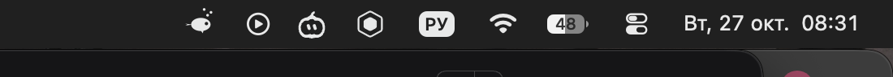

# DSH Bar

An animated whale in the macOS menu bar for **DeepSeek Harness** — see what the agent is doing without switching windows.



> **Status: M2.** The app shows live session state from a running DSH (title, state, model, tokens) and reacts to the Host lifecycle. Approvals and actions are M3.

## What it shows

| State | Menu bar |
|---|---|
| Idle | still whale |
| Thinking / tool running | swimming whale + spout |
| Waiting for approval | red dot next to the whale (M3 wires the buttons) |
| Done | short "done" flash, then idle |
| Error | stays until the next turn starts |
| DSH not running | dimmed whale, popover says why |

Left click opens a popover with the live session: title, step/tool, model, tokens, **Open DSH** and **Quit**. Right-click offers the same plus a login-item placeholder. The app never blocks DSH: it polls a loopback endpoint every 0.8 s and re-reads `runtime.json` before each request (Desktop starts the Host with `--port 0`, so the port changes on every restart).

## Architecture

Two halves, both MIT:

- **`plugin/` — `dsh-bar` host plugin** (npm). Writes `$DSH_HOME/dsh-bar/runtime.json` (`0700`/`0600`, token + origin + pid), mounts `/dsh-bar` on the Host's web server, folds `session/event` / `agent/status` / `agent/error` into a small state document. Message bodies never leave the Host.
- **`app/` — native menu bar app** (Swift, AppKit). Reads `runtime.json`, polls `GET /dsh-bar/status` with a Bearer token, renders the whale. Template images adapt to light/dark menu bars; the whale is drawn in code (no sprite assets).

Security: loopback only, Bearer token on every native route, page routes use same-origin/bridge trust instead of putting the token in page JS.

## Install (development)

```bash
# 1. host plugin into a profile
cd ~/.dsh/profiles/desktop
npx pnpm add link:~/dsh-plugins/dsh-bar/plugin
# add "dsh-bar" to dsh.profile.bundles, then reload the page / restart DSH

# 2. native app
cd ~/dsh-plugins/dsh-bar
./scripts/build.sh
open build/DSHBar.app
```

Debug the bridge without the menu bar: `DSHBar.app/Contents/MacOS/DSHBar --dump-status`.

Environment overrides: `DSH_BAR_RUNTIME_FILE` (tests, multiple homes), `DSH_BAR_DEMO=1` (M1 demo sequence).

## Free distribution

The project is MIT-licensed and distributed for free through GitHub: source builds with one command, and prebuilt releases will ship `DSHBar.app` + the host plugin tarball once M4 lands.

No paid Apple Developer account is used: the bundle is signed **ad-hoc**. On first launch macOS may warn about an unidentified developer — right-click the app and choose **Open**, or run `xattr -dr com.apple.quarantine /Applications/DSHBar.app`.

## Roadmap

- **M1** — native shell, animated whale, popover, demo sequence ✅
- **M2** — host plugin (`dsh-bar`), runtime.json, live state, polling, tests ✅
- **M3** — approve/deny and answer from the popover, open session, stop turn, launch at login
- **M4** — universal binary, GitHub Actions, release packaging, npm publish, catalog entry

## License

MIT
